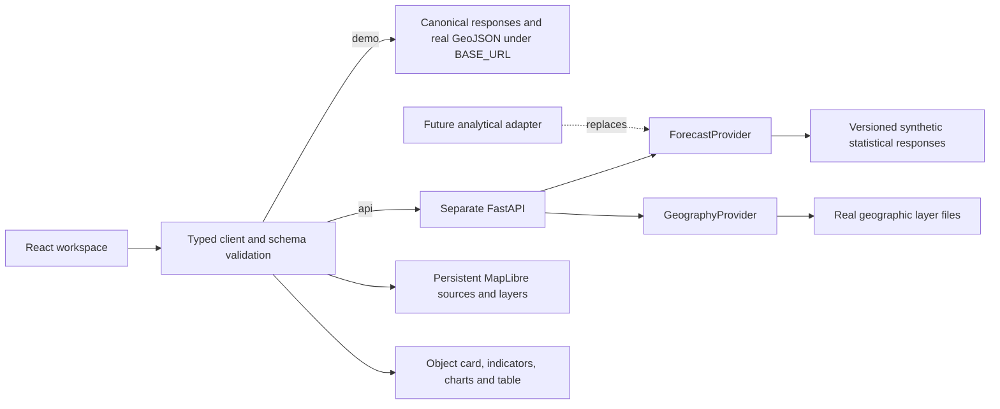

# Architecture

The repository was inspected before implementation: commit `b7dab5f` contained
only `README.md`, with no existing application or project instructions. The
framework now has a Russian annual planning workspace with two interchangeable
data transports and a separate API-only CatBoost road-profile view. The supplied
model has no year feature and does not replace the annual planning provider.

## Components

| Component | Responsibility |
| --- | --- |
| `frontend/` | Year slider, real MapLibre map, map parameters/layers, object card, indicators, comparisons, table, sources and request states |
| `frontend/src/data/` | Demo/API URL selection, generated types and runtime JSON Schema validation |
| `backend/app/forecast_models.py` | Schema 1.2: metadata, geography, finite/null values, aggregates, comparison and interval validation |
| `backend/app/forecast_provider.py` | Replaceable `ForecastProvider`; default `DemoForecastProvider` reads canonical statistical fixtures |
| `backend/app/geography_provider.py` | Independent `GeographyProvider`; default local real GeoJSON layer delivery |
| `backend/app/congestion_model.py`, `model_schemas.py` | Load the supplied CBM once, validate seven raw inputs, compute four cyclic features, return raw index and optional 24-hour profile |
| `backend/models/` | Supplied immutable CBM and provenance manifest; inference uses CatBoost 1.2.10 |
| `backend/app/` | FastAPI routes, parameter/error validation and explicit environment-driven CORS |
| `contracts/fixtures/forecast/` | Thirty forecast combinations, metadata and geography response shared by API/static mode |
| `contracts/geography/` | Real geographic assets, source snapshots, version and individual attribution/licensing |
| `contracts/` | Versioned statistical source, exported OpenAPI/JSON Schemas and generated TypeScript |
| `scripts/` | Contract export, reproducible geography/forecast generation and copying into static assets |
| `backend/tests/`, `frontend/src/**/*.test.*` | Contract, parity, provider replacement, numerical/coverage and UI presentation checks |
| `.github/workflows/` | Shared CI and static GitHub Pages deployment |

There is no authentication, chat, administration, database or job queue.
Legacy corridor endpoints and reusable components remain a compatibility
seam, not an additional screen.

## Supplied model integration

`CongestionWorkspace` → validated model client → `POST /api/v1/model/predict`
→ shared `ModelFeatures` → cyclic transforms from `analyzer.ipynb` → CatBoost
`Pool` with verified names/category indices → raw prediction. The CLI uses the
same service. No notebook cells, fitting, retraining or imputation guesses run
in either path. `catboost_info` logs are not a serving dependency.

The map highlights the context district only: one manually supplied road profile
does not measure the district's mean congestion or all its roads. The hourly
chart evaluates the same model for all 24 hours with the other inputs fixed.
No synthetic forecast values are fed into CatBoost. Unknown year effects,
confidence and intervention intervals are not fabricated. Artifact readiness is
reported separately from the annual provider's status. See
[model integration](model-integration.md) for deployment and remaining data gaps.

## Data flow

1. Read `/metadata`. Base year, available years, metric definitions, scenarios,
   boundaries, source attribution and layer descriptors come from the provider.
   The current source declares base 2026 and every year 2026–2030; no year is
   inferred from the clock or hardcoded into controls.
2. Fetch all advertised years for the selected metric/scenario and validate one
   stable series: model/data version, IDs, geometry, names, baselines and units.
   Selecting a year then reuses one immutable response for all analytical views.
3. The maximum-year response supplies provider-authored critical intervals.
   Their positions and keyboard-selectable markers share the year slider track;
   the frontend never derives intervention windows from a color threshold.
4. Load enabled real context layers separately. Roads, water and stations do not
   wait for the building file. Buildings are requested only when enabled and
   zoom is at least 12. Layer failure is visible without removing district
   boundaries, analytical values, cards, charts or the table.
5. Parameter changes abort superseded requests and clear stale results. Requests
   have a 15-second transport timeout. API failures do not substitute demo data.

## Geography and statistical provenance

Ten district polygons use the published regional government GIS layer, with
all source vertices preserved. The separate Pashino contour remains part of the
Kalininsky `MultiPolygon`. Selection and analytical fills follow those polygons;
the user's raster development plan is a visual reference, not a boundary source.

OpenStreetMap supplies real roads, buildings, water and available rail/metro
stations in the retained city extent. Five actual named road sections support
synthetic transport metric examples. Station points have no invented metric
observations and do not enter aggregates. Population, trip demand, passenger
flow, transport capacity and traffic intensity remain distinct semantics.

`geography_version`, `is_synthetic`, sources and layer terms describe geography.
Statistical `is_demo`, `data_version`, `model_version` and disclaimer describe
forecast provenance. Real geography does not make demonstration figures or
critical intervals model results. OSM assets use ODbL; the government source has
its own published metadata and does not inherit the OSM licence. See
[geographic sources and reproduction](geodata.md).

Versioned geographic snapshots regenerate deterministically with
`python scripts/import_geography.py`; `--check` verifies generated assets without
network access. The forecast source references real geographic IDs and defines
only statistical anchors, fixed changes, missing observations and explicit
interval schedules. Regeneration produces all supported combinations. Tests
separately exercise missing and zero values; they are not invented zero district
populations in the displayed default dataset.

## Interface and synchronization

The sticky header contains only the compact year slider, annual labels and
critical markers. Metric/scenario, district/object selection, refresh and layer
switches live in the map sidebar. Demo provenance remains visible independently
of the chosen transport.

MapLibre is created for component lifetime. Initial camera bounds come from
actual supplied coordinates; year/metric changes update source data and filters
without resetting the camera or recreating layer definitions. Analytical source
updates complete before the new map paint is revealed. Change-color domains
stay fixed across the loaded years for the metric/scenario and unit mode.

One stable selected ID connects the district/object card, map, comparison
columns, year dynamics, signed ranking and table. The minimalist dynamics chart
positions points by calendar year, gives numerical labels and breaks across
missing or incomparable observations. Negative ranking bars extend left of zero;
positive bars extend right. Charts have no pie or decorative animation. Missing
values differ from zero; loading and failure states are explicit.

## API and model integration

Schema 1.2 exposes health, metadata, forecast, geography and geographic layer
routes. `/api/v1/geography` returns the same `Geography` object as metadata;
`/api/v1/geography/layers/{layer_id}` returns only declared real context layers.
Their static equivalents use the same structures. See [API contract](api-contract.md)
and [forecast semantics](forecast-contract.md).

`ForecastProvider` defines `is_demo`, `get_metadata()` and
`get_forecast(*, year, metric, scenario)`. Install a model through
`create_app(forecast_provider=ModelProvider())`; routes stay unchanged. Responses
are revalidated against provider metadata, including identity, geography, units,
coverage and interval references. Nulls remain null and zero baselines never
produce infinite percentages. Mean load is not a sum of percentages, and 100%
load does not specify a replacement share.

`GeographyProvider.get_layer(descriptor)` is independent of the analytical
provider and can be replaced through `create_app(geography_provider=...)`.
Defaults read the checkout's real files; `GEOGRAPHY_DATA_DIR` selects another
asset directory. `FORECAST_DEMO_DATA_DIR` independently selects forecast fixtures.
Health reports process liveness/provider configuration, not model readiness.

## Contract ownership and deployment

Author contracts in Pydantic, export `contracts/openapi.json` and
`contracts/schemas/*.json`, then regenerate `contracts/api.generated.ts`.
Update source, generated fixtures, schemas, tests and consumers together.
`predev`/`prebuild` recreate ignored `frontend/public/demo/` and
`frontend/public/geography/` from canonical files; source acquisition snapshots
are retained in the repository but not copied into the browser distribution.

GitHub Pages serves only `frontend/dist/`; FastAPI launches separately.
`VITE_DATA_MODE=demo|api` and absolute `VITE_API_BASE_URL` select transport at
build time. `VITE_BASE_PATH` supplies the Pages asset prefix; local development
uses `/`. There is no same-origin development proxy or router rewrite.
An HTTPS frontend requires an HTTPS API, with explicit backend CORS origins
without the repository path. `VITE_*` values are public configuration, not secrets.
No external tile/font service or API key is needed for the retained real map.

The deployment boundary follows the official
[Vite GitHub Pages guide](https://vite.dev/guide/static-deploy.html#github-pages)
and [FastAPI CORS documentation](https://fastapi.tiangolo.com/tutorial/cors/).
Map source/layer behavior follows [MapLibre GL JS](https://maplibre.org/maplibre-gl-js/docs/).
